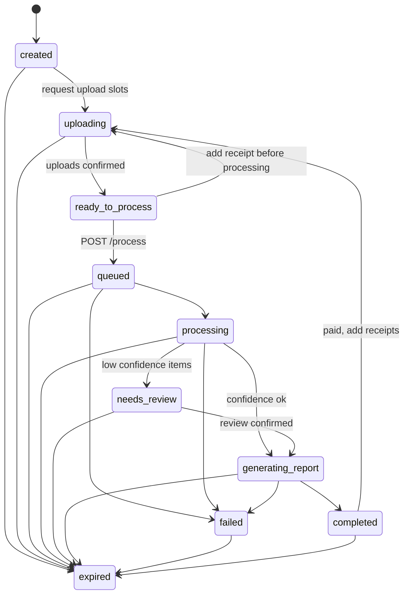
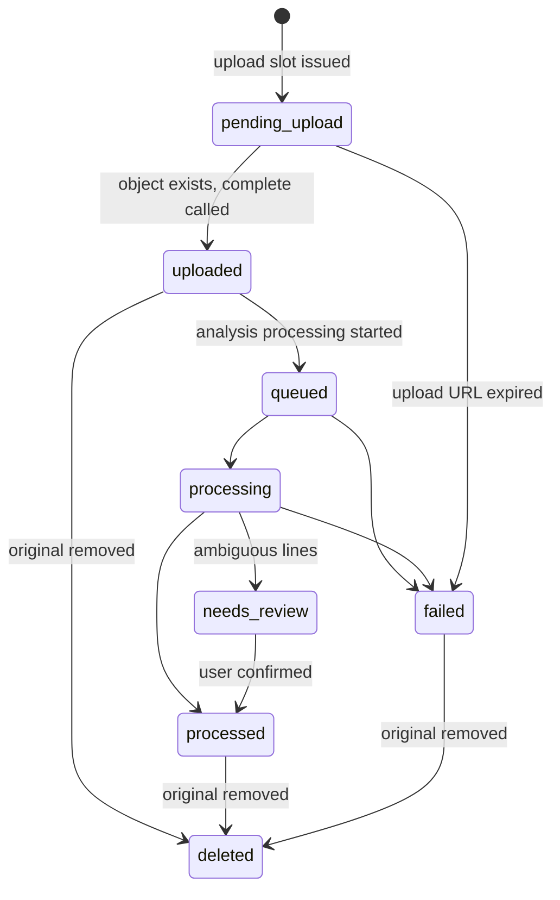

# State machine

Canonical states and transitions for analyses, receipts, processing, review, and paid reprocessing.

## Analysis states

```text
created
uploading
ready_to_process
queued
processing
needs_review
generating_report
completed
failed
expired
```

### Happy path (no review)

```text
created
→ uploading
→ ready_to_process
→ queued
→ processing
→ generating_report
→ completed
```

### Happy path (review required)

```text
created
→ uploading
→ ready_to_process
→ queued
→ processing
→ needs_review
→ generating_report
→ completed
```

Review is optional. An analysis may skip `needs_review` when confidence is sufficient.

### Failure

```text
queued | processing | generating_report
→ failed
```

### Paid reprocessing

A paid analysis may transition from `completed` back to:

```text
uploading
→ ready_to_process
→ queued
→ processing
→ (needs_review)
→ generating_report
→ completed
```

when additional receipts are added (up to 15 total).

### Diagram



`expired` is terminal for original-file retention and stalled work. Extracted structured purchase data is not deleted just because the raw object is gone. See [PRIVACY_RULES.md](./PRIVACY_RULES.md).

## Receipt states

```text
pending_upload
uploaded
queued
processing
needs_review
processed
failed
deleted
```



Deletion of the raw object does **not** mean deleting extracted structured purchase data.

`deleted` on a receipt means the original file is gone. Structured items, totals, and store data may remain.

## Processing pipeline

Canonical flow for each receipt, then the analysis:

```text
uploaded receipt
      ↓
image/PDF preparation
      ↓
preprocessing
      ↓
primary OCR
      ↓
receipt parser
      ↓
confidence evaluation
      ↓
fallback vision/OCR if needed
      ↓
PII filtering
      ↓
structured receipt
      ↓
product normalization
      ↓
confidence evaluation
      ↓
user review if necessary
      ↓
deterministic analytics
      ↓
AI narrative/personality
      ↓
report
```

`GET /analyses/{analysis_id}` MAY include `progress` while `status` is `queued`, `processing`, or `generating_report`:

```json
{
  "stage": "normalizing_products",
  "percent": 72,
  "message": "Organizando tus compras"
}
```

`stage` is an opaque snake_case string. `message` is Mexican Spanish, user-facing, and must not leak PII. `percent` is 0–100.

`POST /analyses/{analysis_id}/process` must be idempotent. Repeating it on an already queued/processing analysis must not start a second job; it returns the current processing status.

## Review loop

1. Processor emits `review_issues` for ambiguous items only.
2. Analysis enters `needs_review`.
3. `GET /analyses/{analysis_id}/review` returns every ambiguous issue while
   review is open, including already-resolved issues. Each issue exposes
   `resolution` (`null` while unresolved). Refresh/reopen restore successful
   prior actions from this resource.
4. Client `PATCH`es each issue with `accept`, `edit`, `remove`, or
   `unrecognized`. `accept` / `remove` / `unrecognized` send only `action`.
   `edit` sends at least one correction among `product_name`, `quantity`,
   `line_total`, and the `size_value`+`size_unit` pair. PATCH is a resource
   update: repeating the same valid request does not duplicate side effects;
   the latest valid persisted resolution is authoritative. The user may
   change an issue until confirmation.
5. `POST /analyses/{analysis_id}/review/confirm` is permitted only when every
   issue has a persisted resolution. Otherwise the API returns
   `409 REVIEW_INCOMPLETE` with `unresolved_count` and `unresolved_issue_ids`.
   On success the backend resumes the canonical lifecycle and returns the
   updated Analysis. Clients recover unknown outcomes with GET Analysis, not
   blind mutation retries. Further review mutations after leaving
   `needs_review` are invalid.
6. Analysis enters `generating_report`.

The frontend should normally show only ambiguous items, with a count of total vs. needing help (unresolved issues). Unsaved form drafts are not canonical persistence.

## Monthly usage and processing capacity

Every analysis has a 15-document processing ceiling. Separately, an owner may
accept five Free or 100 One documents per owner-local calendar month. Usage is
atomically reserved across concurrent analyses. Capacity is consumed when a
sanitized extraction is durably accepted (including items awaiting review), and
released on terminal rejection/failure before accepted extraction. Retries of
the same receipt record are idempotent. Exact same-file duplicates by one owner
inside the same month consume only one slot.

`POST /analyses/{analysis_id}/uploads` rejects an exhausted analysis bound with
`RECEIPT_LIMIT_REACHED`, and an exhausted monthly allowance with
`USAGE_LIMIT_REACHED`.

Uploading is valid in `created` and `uploading`. Before processing begins, a
valid slot request may also move `ready_to_process` back to `uploading` when
capacity remains. `completed` may receive additional documents only while the
account has unused monthly capacity and the analysis remains under its
15-document cap.

An active pending slot is a `pending_upload` receipt whose
`upload_expires_at > now()`. Capacity counts confirmed `uploaded` receipts plus
active pending slots. Expired pending slots become `failed` internally and do
not consume capacity.

Upload completion accepts any non-empty subset of issued receipt IDs and is
idempotent. `uploading → ready_to_process` requires at least one uploaded
receipt and zero active pending slots.

Processing may start only when the analysis is `ready_to_process` (or idempotently already `queued`).
The first valid request from `ready_to_process` creates one processing run and
returns `200` with `queued`. A repeat while that run is `queued` returns the
same `200` response and creates no second run. After a processor advances the
analysis to `processing`, or after any later processing/report state, a new
request returns `409 PROCESSING_ALREADY_STARTED` and does not restart it.

Report is available only when `status` is `completed` (`REPORT_NOT_READY` otherwise).

## API-facing analysis resource

Minimum fields:

| Field | Meaning |
| --- | --- |
| `id` | `ana_…` |
| `mode` | `"free"` at creation. Does not flip on payment. |
| `status` | analysis state |
| `max_receipts` | 15-document processing bound; monthly allowance is account-wide |
| `receipt_count` | receipts accepted so far |
| `created_at` | ISO 8601 |
| `progress` | optional, while in-flight |

Account plan, subscription and monthly usage are read from `GET /me` and
`GET /subscriptions`, not from analysis `mode`.
